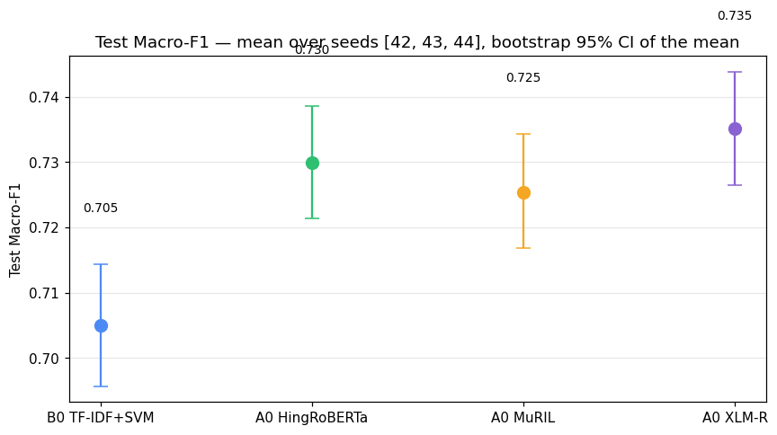
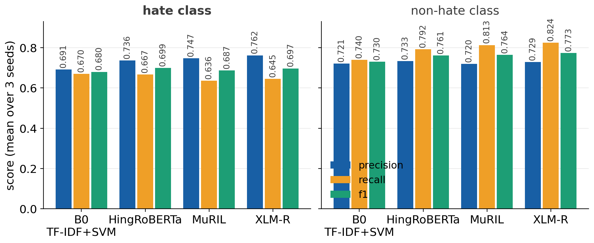
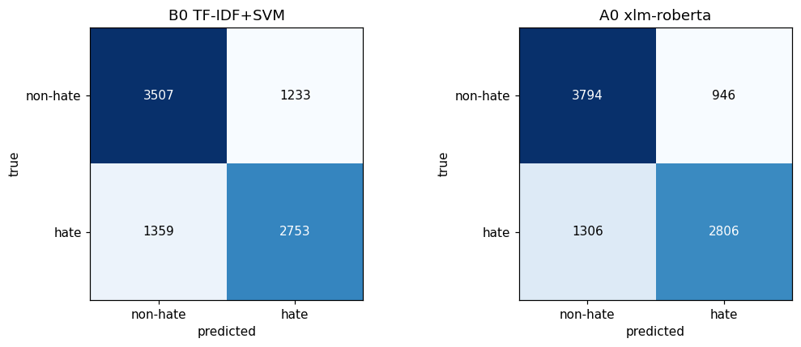
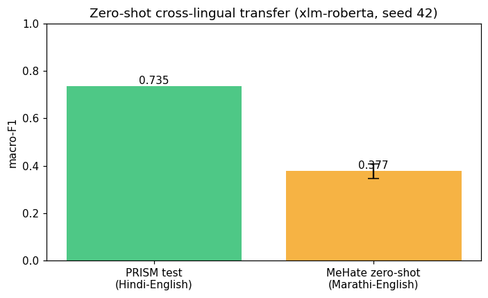

# Code-Mixed Hinglish Hate Speech Detection

<p align="center">
  
  
  
  
  
</p>

**Stack:** Python · scikit-learn · PyTorch · Hugging Face Transformers · Gradio · pandas / NumPy · Matplotlib

**Team:** Anish Charudatta Date (EN25552003) · Soham Nilesh Vaidya (EN25552017) — M.Tech II (AI & DS), VPKBIET Baramati · **Guide:** Dr. Arvind Jagtap

---

## 1. Problem statement

Social media in India is overwhelmingly **code-mixed**: a single post mixes Hindi and English, usually with Hindi *romanised* (written in Latin script, e.g. *"bhai ye kis level ki ghatiya soch hai"*). Monolingual hate-speech systems break on this distribution because:

- romanisation shatters tokenisation and vocabulary coverage,
- the *same* reply can be hateful or harmless depending on its **parent post** (conversational context),
- available code-mixed datasets are small and noisy.

We frame the task as **binary hate detection on code-mixed Hinglish text**: label each post as **hate (1)** vs **non-hate (0)**. The open dataset we use ships single posts only — no parent thread — so conversational context is documented as **future work** rather than used here.

## 2. Models compared

| | Model | Backbone | Input | Why |
|---|---|---|---|---|
| 🔵 **B0 (baseline)** | Char $n$-gram TF-IDF + Linear SVM | `TfidfVectorizer` + `LinearSVC` | post text only | Classical, GPU-free reference that survives romanisation/noise — **not a strawman**. |
| 🟢 **A0-a** | HingRoBERTa (fine-tuned) | `l3cube-pune/hing-roberta` (278M) | post text | Pretrained on romanised Hindi–English — our exact input distribution. |
| 🟢 **A0-b** | MuRIL (fine-tuned) | `google/muril-base-cased` (238M) | post text | Pretrained on Indian languages **including transliterated text**. |
| 🟢 **A0-c** | XLM-RoBERTa (fine-tuned) | `xlm-roberta-base` (278M) | post text | 100-language generalist; the strongest of the three on PRISM. |

**Fairness contract** *(identical to §Methodology of the report)*:

> *"Both models are trained and evaluated on the identical stratified split, using the same de-identification pipeline, the same decision-threshold policy (tuned only on the validation split), the same three random seeds, and the same held-out test set. The only differences between B0 and A0 are the representation learner and the classifier head, both of which are properties of the models under comparison rather than of the experimental setup."*

## 3. Dataset

**Dataset:** [`pankajbiswas6/prism-hinglish-hate-speech`](https://huggingface.co/datasets/pankajbiswas6/prism-hinglish-hate-speech) — **MIT licensed, ungated, open source**, revision pinned in the pipeline.

| Attribute | Value |
|---|---|
| Licence | **MIT** — fully open, attribution required |
| Access | Ungated · `load_dataset("pankajbiswas6/prism-hinglish-hate-speech")` |
| Size | 29,506 rows — train 17,704 / val 2,950 / test 8,852 (**already split**) |
| Columns | `text`, `label` (0 = non-hate, 1 = hate), `lang` (`english` / `hindi` / `hinglish`) |
| Composition | English 15,000 · Hindi (Devanagari) 9,767 · **Hinglish 4,783** |
| Balance | non-hate 53.5% / hate 46.5% |

**De-identification (required):** `@handles` → `<USER>`, URLs → `<URL>`, email addresses and phone numbers → placeholders; unusually long repeated-letter sequences shortened; emojis **kept**. Raw downloads are **never** committed (see `.gitignore`).

## 4. Evaluation

1. **Effectiveness (primary):** macro-F1 + per-class P/R/F1.
2. **Imbalance robustness:** MCC + balanced accuracy.
3. **Statistical reliability:** bootstrap 95% CI (1,000 resamples) + exact McNemar's test with Holm correction.
4. **Cost:** train seconds · parameter count · ms/inference.

## 5. Results — final three-seed run

Test set = 8,852 held-out PRISM posts; values are mean ± std over seeds 42/43/44.

| Model | Test macro-F1 | MCC | Train time / seed | ms/item |
|---|---|---|---|---|
| **B0** TF-IDF + LinearSVC | **0.7050 ± 0.0000** | 0.4104 | 8.9 s | 0.50 |
| HingRoBERTa | 0.7300 ± 0.0046 | 0.4639 | 856 s | 6.56 |
| MuRIL | 0.7254 ± 0.0036 | 0.4582 | 823 s | 6.88 |
| **XLM-RoBERTa** | **0.7351 ± 0.0064** | 0.4794 | 857 s | 6.60 |

> **Headline:** the best transformer (XLM-R) outperforms B0 by Δmacro-F1 = **+0.0301** [95% CI 0.7265–0.7439]; exact McNemar with Holm correction **p_adj = 1.2×10⁻¹³** (HingRoBERTa 7.5×10⁻⁹ · MuRIL 3.1×10⁻⁴) — all three gains significant.

**Per-class behaviour (mean over seeds).** Hate recall is the weakest cell for *every* model — B0 0.670 · HingRoBERTa 0.667 · MuRIL 0.636 · XLM-R 0.645 — against non-hate recall of 0.740–0.824. Hate *precision* is best for XLM-R (0.762). The models are conservative: ambiguous posts are labelled non-hate, so moderation queues absorb the misses.

**Per language (seed 42).** A0 macro-F1: English **0.8189** · Hinglish **0.6680** · Hindi **0.6233** (B0: 0.7723 / 0.6312 / 0.6215). The code-mixed bucket is the hardest: at seed 42, XLM-R misclassifies **32.0%** of the 1,214 posts in the 0.20–<0.50 mixing bucket.

**Zero-shot transfer.** The validation-selected XLM-R model applied to **L3Cube-MeHate** (Marathi–English, 416 posts, threshold 0.53 carried from PRISM-val) reaches macro-F1 **0.3770** [95% CI 0.3454–0.4088] — a collapse of 35.81 points from 0.7351. Domain shift, not architecture, is the binding constraint.

> **Note:** the numbers above are from the final executed run (Kaggle GPU notebook — the working demo, linked below) and match the 30-page report. Machine-readable copies of every table live in [`results/`](results/).


### Figures

<p align="center"></p>
<p align="center"><em>Test macro-F1 with 95% bootstrap confidence intervals (1,000 resamples).</em></p>

<p align="center"></p>
<p align="center"><em>Per-class behaviour: hate recall is the weakest cell for every model.</em></p>

<p align="center"></p>
<p align="center"><em>Confusion matrices on the PRISM test set (seed 42).</em></p>

<p align="center"></p>
<p align="center"><em>Zero-shot transfer: PRISM (Hindi–English) vs MeHate (Marathi–English).</em></p>

## 6. Repository layout

```
hinglish-hate-detection/
├── README.md               ← you are here
├── requirements.txt        ← pinned versions
├── .gitignore
├── data/
│   ├── raw/                ← downloaded raw data (gitignored)
│   └── processed/          ← de-identified CSV + DATASET.md (sha256)
├── src/
│   ├── prepare_data.py     ← M1: loader + PII stripper + stratified split
│   ├── baseline_b0.py      ← M2: TF-IDF char 2-5gram + LinearSVC
│   ├── advanced_a0.py      ← M3: transformers, 3 seeds
│   ├── evaluate.py         ← M2: metrics, bootstrap CI, McNemar
│   ├── make_tables.py      ← M4: results.csv → tables + figures
│   └── predict.py          ← M4: export model for inference
├── results/                ← results.csv + summary, per-class, McNemar, per-language and transfer tables
├── figures/                ← 11 figure PNGs from the final run (four embedded below)
├── app/app.py              ← M4: Gradio demo
├── notebooks/01_eda.ipynb
├── report/                 ← submitted report (added at submission)
└── slides/                 ← submitted presentation (added at submission)
```

**Working demo:** the fully executed Kaggle GPU notebook — every output and figure in the report — is available at
[kaggle.com/code/anishdate/code-mixed-hate-speech-detection-pipeline-v2](https://www.kaggle.com/code/anishdate/code-mixed-hate-speech-detection-pipeline-v2).

## 7. How to run

```bash
pip install -r requirements.txt
# 1) Data (M1) — downloads the MIT dataset → data/processed/{train,val,test}.csv
python src/prepare_data.py --lang hinglish --out data/processed
# 2) Baseline (M2, CPU ~2 min)
python src/baseline_b0.py --seeds 42 43 44 --out results/results.csv
# 3) Transformers (M3, GPU)
python src/advanced_a0.py --seeds 42 43 44
# 4) Metrics + CI + McNemar (M2)
python src/evaluate.py --preds results/ --out results/results.csv
# 5) Tables + figures (M4)
python src/make_tables.py --csv results/results.csv --out figures/
# 6) Demo (M4)
python app/app.py
```


## 8. References

- Khanuja et al. (2021). *MuRIL: Multilingual Representations for Indian Languages.* arXiv:2103.10730.
- Nayak & Joshi (2022). *L3Cube-HingCorpus and HingBERT.* WILDRE-6 @ LREC.
- Conneau et al. (2020). *Unsupervised Cross-lingual Representation Learning at Scale.* ACL.
- Pedregosa et al. (2011). *Scikit-learn: Machine Learning in Python.* JMLR 12.
- Wolf et al. (2020). *Transformers: State-of-the-art Natural Language Processing.* EMNLP System Demos.
- Efron & Tibshirani (1993). *An Introduction to the Bootstrap.* Chapman & Hall/CRC.
- McNemar (1947). *Note on the sampling error of the difference between correlated proportions or percentages.* Psychometrika 12(2).
- Holm (1979). *A simple sequentially rejective multiple test procedure.* Scand. J. Statist. 6.

---

*Full citations, methodology and the complete result tables are in the submitted 30-page report; the presentation is submitted separately. This README documents the code that produces every number in them.*
